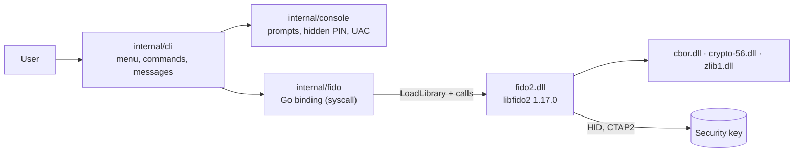

# fido2-tool

[](https://github.com/marcelocapozzi/fido2-tool/actions/workflows/ci.yml)

A small Windows command-line tool for end users to manage the passkeys stored
on a FIDO2 security key, such as a YubiKey 5 NFC. Its main job is to change the
**user name** and **display name** of a passkey that is already on the key.
It can also list and delete passkeys, set or change the PIN, and
factory-reset the key.

It is built on Yubico's [libfido2](https://github.com/Yubico/libfido2) and
written in Go, with no cgo.

## Features

- **Key information**: firmware, CTAP versions, algorithms, PIN state and retries, free passkey slots, and whether the key can rename passkeys.
- **Passkeys**: list them all, grouped by site. Change the user name and/or display name. Delete one.
- **PIN**: set a first PIN or change the existing one. The key's minimum length is enforced.
- **Factory reset**: guided unplug, replug and touch sequence.
- **Two ways to use it**: a menu for double-click users, and commands with flags for scripting.
- **Elevation**: asks for administrator rights through UAC when needed.

## Requirements

- Windows 10 1903 or later, or Windows 11, on x64.
- **Administrator rights.** Since Windows 10 1903, only elevated processes
  can talk to FIDO keys over HID. Everything else goes through Windows Hello,
  which can sign in but cannot manage a key. fido2-tool relaunches itself
  through UAC when it is started without those rights.
- A FIDO2 key connected over **USB**. NFC readers are not supported, because
  the libfido2 Windows build does not include PC/SC support.
- For renaming: a key that implements **CTAP 2.1** (`FIDO_2_1`). A YubiKey 5
  needs firmware 5.7 or later. Older keys implement only CTAP 2.1-PRE, which
  can list and delete passkeys but cannot edit them. `fido2-tool info` shows
  whether your key supports renaming.

## Installation

Download `fido2-tool-<version>-windows-amd64.zip` from the
[releases](https://github.com/marcelocapozzi/fido2-tool/releases) page and
extract the whole folder. Keep the `.dll` files next to `fido2-tool.exe`.

```
fido2-tool\
├── fido2-tool.exe
├── fido2.dll  cbor.dll  crypto-56.dll  zlib1.dll   libfido2 and its dependencies
├── vcruntime140.dll                                Visual C++ runtime (app-local)
├── README.txt                                      end-user instructions
└── licenses\
```

The executable is not code-signed yet, so Windows SmartScreen may warn the
first time it runs.

## Usage

Double-click `fido2-tool.exe`, or run it without arguments, to open the menu:

```
fido2-tool 0.1.0 - manage FIDO2 security keys

  1) List connected keys
  2) Show key information
  3) List stored passkeys
  4) Change the user name or display name of a passkey
  5) Delete a passkey
  6) Set or change the PIN
  7) Factory-reset the key (erases everything)
  0) Exit
```

The same actions are available as commands:

| Command | What it does |
|---|---|
| `fido2-tool list` | List connected keys (`-v` also prints device paths) |
| `fido2-tool info` | Show key information (`-v` also prints all options) |
| `fido2-tool creds` | List stored passkeys (asks for the PIN) |
| `fido2-tool rename` | Change a passkey's user name and/or display name |
| `fido2-tool delete` | Delete a passkey |
| `fido2-tool pin` | Set or change the PIN |
| `fido2-tool reset` | Factory-reset the key |
| `fido2-tool help` | Show all options |

| Option | Meaning |
|---|---|
| `-d, --device <n>` | Key to use (number from `list`, or a device path) when several are connected |
| `--cred <id>` | Passkey to act on: the ID shown by `creds` (any unique prefix) or the full credential ID in base64url |
| `--name <text>` | New user name (`rename`) |
| `--display-name <text>` | New display name (`rename`) |
| `-y, --yes` | Skip the confirmation prompt (`rename`, `delete`) |
| `-v, --verbose` | More details (`list`, `info`) |
| `--debug` | Print libfido2's protocol trace to stderr |

### Renaming a passkey

Interactively:

```
> fido2-tool rename
Key PIN:
 #  Site         User name  Display name  ID
 1  github.com   jdoe       John Doe      3f9a1c0e22b4
 2  example.com  john       -             a07c5d19e3f0

Number of the passkey to edit (Enter to cancel): 1

Passkey for github.com. Type a new value, or press Enter to keep the current one.
User name [jdoe]:
Display name [John Doe]: John Doe (work)

Passkey for github.com (ID 3f9a1c0e22b4):
  Display name: "John Doe" -> "John Doe (work)"
Apply the change? [y/N]: y
Done. User name: jdoe   Display name: John Doe (work)
```

Without prompts, for scripts:

```
fido2-tool rename --cred 3f9a1c --display-name "John Doe (work)" --yes
fido2-tool rename --cred 3f9a1c --name "john.doe"
```

A field you don't pass keeps its current value. Passing an empty value
(`--display-name ""`) clears it.

What renaming does and doesn't change:

- It changes the `user.name` and `user.displayName` that the key stores and
  shows when you pick an account at sign-in.
- It does **not** change `user.id` (the user handle). That is what the website
  uses to identify the account, so signing in keeps working.
- The website is **not** told about the change, and your account name on the
  site stays the same.
- If you register the key again on the same site, the site's values replace
  yours.
- Each field is limited to 64 bytes of UTF-8. CTAP 2.1 allows keys to
  truncate longer values, so the tool rejects them instead of letting the key
  cut them silently.

## How it works



### Binding libfido2 without cgo

`internal/fido` loads `fido2.dll` at runtime with `syscall.LazyDLL` and calls
its C functions directly. There is no cgo, so a plain `go build` works with no
C compiler. A few details make this safe:

- **Explicit DLL loading.** The dependencies (`vcruntime140.dll`,
  `zlib1.dll`, `crypto-56.dll`, `cbor.dll`) are loaded first, by absolute path
  from the executable's directory, and then `fido2.dll`. Its imports resolve to
  those copies and never to whatever is on `PATH`. At startup every function
  the tool uses is resolved, so a mismatched DLL fails right away with a clear
  error.
- **Opaque handles.** libfido2's API works with opaque pointers
  (`fido_dev_t *`, `fido_cred_t *`, ...) plus getters. Go never has to mirror
  C struct layouts, only pass pointers and read back strings and byte arrays,
  which are copied into Go memory immediately.
- **Pointer rules.** Go pointers are only passed to C inside the call
  expression of a `//go:uintptrescapes` helper. That keeps them alive and in
  place for the duration of the call. Return values are narrowed to their C
  types: `bool` reads only the low byte, and `int` is 32 bits.

### Talking to the key

Every operation opens the key, runs one or more CTAP2 commands through
libfido2, and closes it:

| Action | CTAP2 command | libfido2 function |
|---|---|---|
| Key information | `authenticatorGetInfo` | `fido_dev_get_cbor_info` |
| List passkeys | `authenticatorCredentialManagement`: `getCredsMetadata`, `enumerateRPs*`, `enumerateCredentials*` | `fido_credman_get_dev_metadata`, `_get_dev_rp`, `_get_dev_rk` |
| Rename | `authenticatorCredentialManagement`: `updateUserInformation` | `fido_credman_set_dev_rk` |
| Delete | `authenticatorCredentialManagement`: `deleteCredential` | `fido_credman_del_dev_rk` |
| PIN | `authenticatorClientPIN` | `fido_dev_set_pin`, `fido_dev_get_retry_count` |
| Reset | `authenticatorReset` | `fido_dev_reset` |

Credential management operations need a PIN/UV auth token, which libfido2
obtains from the PIN over an encrypted channel (PIN protocol 1 or 2) for each
call.

To rename, the tool first lists the passkeys to get the credential ID and the
stored `user.id`. It then sends `updateUserInformation` with the same
`user.id` and the new name and display name. The authenticator replaces the
whole user entity, so a field you don't change is sent with its current
value. Finally the tool reads the passkey back and shows what the key
actually stored.

### PIN handling

- The PIN is typed with console echo turned off. The echo is restored on
  Ctrl+C too, because the console mode outlives the process.
- The PIN is never written to disk or passed on the command line. In the menu
  it is kept in memory for the session, so the user types it once, and it is
  dropped when the key changes or the PIN is wrong.
- After a wrong PIN the tool shows the attempts left and allows up to three
  tries in a row. Most keys require re-plugging after three consecutive
  failures, and they block the PIN after eight.

### Elevation

At startup the tool checks `IsUserAnAdmin`. If it isn't elevated, it
relaunches itself with the same arguments through `ShellExecute("runas")`,
which shows the UAC prompt. The elevated copy runs in its own console window.
When a process owns its console window (double-click or relaunch), it waits
for Enter before closing so the output can be read.

## Building from source

Prerequisites:

- Go 1.26 or later.
- Visual Studio 2022 or its Build Tools. This is only needed so the build
  script can bundle `vcruntime140.dll`. The Go code needs no C toolchain.

```powershell
git clone https://github.com/marcelocapozzi/fido2-tool
cd fido2-tool
.\scripts\build.ps1                  # vet, test, build and package
.\scripts\build.ps1 -Version 0.1.0   # stamp an explicit version
```

The output is `dist\fido2-tool\`, `dist\fido2-tool-<version>-windows-amd64.zip`
and the zip's `.sha256` file.
Before packaging, the script checks the vendored DLLs against
`third_party/libfido2/SHA256SUMS` and verifies their Yubico Authenticode
signatures.

To run the tests only:

```powershell
go test ./...
```

The tests need no security key. `internal/fido` also loads the vendored DLLs
and checks that every function the tool uses is exported. Anything that needs
a real key must be tested by hand; see [Manual testing](#manual-testing).

### Project layout

```
cmd/fido2-tool/        entry point
internal/cli/          commands, menu, argument parsing, user-facing messages
internal/console/      console input, hidden PIN entry, UAC elevation
internal/fido/         libfido2 binding (syscall, no cgo)
third_party/libfido2/  vendored libfido2 DLLs, checksums and licenses
packaging/             files shipped in the release zip
scripts/build.ps1      build and packaging script
scripts/release-notes.ps1  extracts a version's notes from CHANGELOG.md
.github/workflows/     CI: gofmt, vet, test, build; release on v* tags
CHANGELOG.md           release history, the source of the release notes
```

### Releasing

Release notes come from [CHANGELOG.md](CHANGELOG.md), which follows
[Keep a Changelog](https://keepachangelog.com/en/1.1.0/). Changes pile up
under `## [Unreleased]` until the next release.

1. In `CHANGELOG.md`, rename `## [Unreleased]` to the new version and date,
   for example `## [0.1.0] - 2026-09-27`. Then add a fresh, empty
   `## [Unreleased]` above it.
2. Preview the notes:
   ```powershell
   .\scripts\release-notes.ps1 -Version 0.1.0
   ```
3. Commit, tag and push:
   ```powershell
   git commit -am "Release 0.1.0"
   git tag v0.1.0
   git push origin main v0.1.0
   ```

On a `v*` tag, CI does the following:

- It fails before building if `CHANGELOG.md` has no dated section for the
  version.
- It builds and tests the tool, and stamps the version from the tag into the
  binary.
- It publishes a GitHub release. The release attaches
  `fido2-tool-<version>-windows-amd64.zip` and its `.sha256` file, and its
  notes are the changelog section followed by the zip's SHA-256.
- A tag with a hyphen, such as `v0.2.0-rc.1`, is published as a
  pre-release. It needs its own `## [0.2.0-rc.1] - YYYY-MM-DD` section.

On every other push and pull request, the zip is kept only as a workflow
artifact, not as a release.

Users can check a download against the published checksum:

```powershell
(Get-FileHash .\fido2-tool-0.1.0-windows-amd64.zip -Algorithm SHA256).Hash
```

## Manual testing

With a key plugged into a machine where you have administrator rights, run:

1. `fido2-tool info`. Check the firmware and that *Rename passkeys* says
   `supported`.
2. `fido2-tool creds`. Your passkeys should be listed.
3. `fido2-tool rename`. Change the display name, then run `creds` again.
4. Run the same commands with a wrong PIN, and with two keys plugged in.

If something fails, run the same command with `--debug` and attach the output
to the issue. It shows the CTAP traffic. The PIN does not appear in plain
text, because libfido2 only sends it encrypted.

## Third-party components

The release bundles libfido2 1.17.0 (BSD-2-Clause, Yubico AB), libcbor 0.13.0
(MIT), LibreSSL 4.1.0 (OpenSSL/SSLeay/ISC), zlib 1.3.1 (zlib) and the
Microsoft Visual C++ runtime (redistributable). See
[third_party/libfido2](third_party/libfido2/README.md) for where the files
come from, their licenses, and how to update them.

## License

[MIT](LICENSE)
